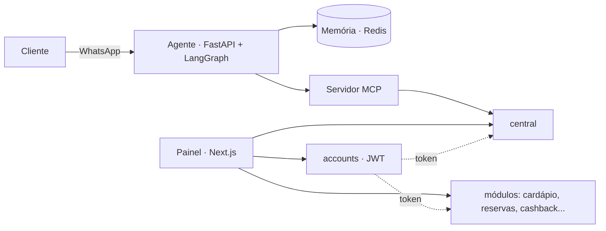

# Plataforma modular para restaurantes, com agente de IA no WhatsApp

> Sistema em módulos contratáveis (cardápio digital, reservas, cashback e outros), construído em microsserviços, com um agente de IA que atende clientes pelo WhatsApp.

> 🔒 **Repositório vitrine.** O código-fonte é privado. Aqui estão a arquitetura e as decisões técnicas. Demonstração técnica disponível sob solicitação.

## O problema

Restaurantes usam vários sistemas desconectados: um para cardápio, outro para reservas, outro para fidelidade. Esta plataforma reúne tudo em um painel, e cada restaurante contrata só os módulos de que precisa.

## Módulos

- **Accounts**: login, restaurantes, assinaturas e produtos contratados; emite o token de acesso (JWT)
- **Central**: produtos, mesas e ambientes, pedidos e clientes
- **Cardápio digital**
- **Widget de reservas** para o site do restaurante
- **Cashback** (programa de fidelidade)
- **Agente de IA no WhatsApp**, que consulta o sistema por um servidor MCP
- **Painel administrativo** único para todos os módulos

## Arquitetura

Regras de arquitetura registradas em ADRs:

1. **Um módulo, um dono.** Cada módulo é um serviço independente.
2. **Um banco por restaurante**, compartilhado pelos módulos, com tabelas prefixadas por módulo.
3. **Nenhum módulo lê a tabela de outro.** Dados de outro módulo chegam por API ou por evento.
4. **O restaurante vem só do token de login**, nunca de header ou do corpo da requisição.
5. **Spec antes do código, teste junto com o código.**

## Destaques técnicos

- **Gerador de módulos**: um comando cria o serviço novo já com login, bloqueio por produto contratado, tabelas, telas no painel e registros
- Comandos de monorepo para subir os serviços por grupos, com diagnóstico do ambiente
- Agente de IA desacoplado do backend: acessa os dados só pelas ferramentas do servidor MCP
- Decisões de arquitetura documentadas em ADRs, com guia do desenvolvedor e fluxo de trabalho de equipe
- Suíte de testes automatizados em todos os serviços (PHPUnit, pytest)

## Stack

| Camada | Tecnologias |
|---|---|
| Serviços | PHP 8.2, Laravel, JWT |
| IA | Python, FastAPI, LangGraph, MCP, Redis |
| Frontend | Next.js, React, TypeScript |
| Ferramentas | Monorepo com scripts próprios (setup, doctor, dev, new-module), Docker |

## Status

Em desenvolvimento ativo.

## Autor

**Felipe Lopes** · Full-stack e fundador da [FML Tech](https://fmlsoftware.com.br)
Arquitetura de microsserviços, ferramentas do monorepo e agente de IA.
